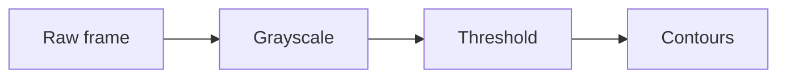

# Widgets reference

A single-page reference for every widget that can appear inside a lesson
section. Use it together with the lesson schema (`src/lib/schemas/lesson.ts`)
when authoring lesson JSON.

## How to use this reference

This document is consumed by the `init_course` and `generate_lesson` skills
(under `scripts/ralph/skills/`) when they author lesson JSON. Each widget
entry below lists its purpose, the key fields on `section.data`, a minimal
valid example, and links to the canonical Zod schema and sample fixture in
`src/widgets/<Name>/`.

**The Zod schemas in `src/widgets/<Name>/schema.ts` are the source of
truth.** If this document and the code disagree, trust the code — open the
schema file and follow it. This page is a curated summary, not a contract.

Every section in a lesson shares a common envelope (`id`, `title`, `type`,
`data`, optional `sources`) defined by `SectionSchema` in
`src/lib/schemas/lesson.ts`. The fields below describe only the per-widget
`data` payload — the envelope is the same for every widget.

The full list of registered widget types is in `src/widgets/registry.ts` and
the discriminated union of section variants is in
`src/lib/schemas/lesson.ts → SectionSchema`.

**The widget set is not closed.** If your lesson has a clear pedagogical
need that none of the entries below cleanly express, you may author a new
first-class widget type rather than abuse `custom`. See
[`src/widgets/README.md`](../src/widgets/README.md) for the 5-step procedure
and `generate_lesson/SKILL.md → Step 3a` for the gating criteria (a new type
must pay for itself across 2–3 future lessons; one-off content stays in
`custom`).

| Widget                | `type` literal       | Hands-on?         |
|-----------------------|----------------------|-------------------|
| Theory                | `theory`             | reading           |
| Quiz                  | `quiz`               | conceptual check  |
| Code                  | `code`               | graded coding     |
| CodeCloze             | `codeCloze`          | fill-in-the-blank |
| DataTable             | `dataTable`          | tabular reference |
| Demo                  | `demo`               | slider demo       |
| DragMatch             | `dragMatch`          | drag-and-drop     |
| Histogram             | `histogram`          | static figure     |
| ParametricExplorer    | `parametricExplorer` | live Python      |
| PlotImage             | `plotImage`          | static figure     |
| Sandbox               | `sandbox`            | free coding       |
| Video                 | `video`              | embedded video    |
| EegViewer             | `eegViewer`          | read real/simulated EEG |
| MontageLab            | `montageLab`         | montage simulator |
| EegFigureMark         | `eegFigureMark`      | mark on a figure  |
| PatternDrill          | `patternDrill`       | recognition drill |
| EegCase               | `eegCase`            | staged case       |
| FigureSequence        | `figureSequence`     | step/slide/compare figures |
| Custom                | `custom`             | escape hatch      |

---

## Theory

Markdown-rendered prose with KaTeX support. The spine of every lesson — use
it to introduce concepts, derive formulas, and frame the interactive
sections that follow. Inline images (``) are encouraged for any
section longer than ~300 characters of prose.

| Field      | Type   | Required | Meaning                                              |
|------------|--------|----------|------------------------------------------------------|
| `markdown` | string | yes      | Markdown body. Supports `$inline$` / `$$block$$` math, fenced code, `:::callout{}` blocks, and inline image references. |

Minimal example:

```json
{
  "id": "intro",
  "title": "What is a convolution?",
  "type": "theory",
  "data": {
    "markdown": "A **convolution** smooths a signal by replacing each sample with a weighted average of its neighbours."
  }
}
```

### Mermaid diagrams

Theory markdown also renders [Mermaid](https://mermaid.js.org/) diagrams from a
fenced ```` ```mermaid ```` block (US-216). The diagram is drawn as an SVG in the
lesson view, the print/PDF export, and the static HTML export — all from the same
fenced block, no extra fields. The diagram inherits the active theme
(light / dark / sunset) automatically.

Syntax — just a fenced block whose info-string is `mermaid`:

````markdown

````

**Supported diagram types:** `flowchart` (a.k.a. `graph`) and `sequenceDiagram`
are the workhorses; `mindmap` also renders. Stick to these — exotic diagram
types may not parse.

**When to use it** — reach for a Mermaid diagram when the relationship between
parts *is* the lesson:

- **Pipelines / processing stages** — image-processing chains, ETL, a training loop.
- **Data / control flow** — how a signal or request moves through a system.
- **Concept maps** — how terms relate (is-a, depends-on, leads-to).
- **Architectures / state machines** — module boxes and their connections, FSM states.

**When NOT to use it:**

- **Formulas / math** → use KaTeX (`$inline$` / `$$block$$`), not a diagram.
- **Quantitative charts** (curves, distributions, error-vs-iteration) → use
  `plotImage` (real axes, tick labels, units) or `histogram`. Mermaid has no
  numeric axes.
- **Photographic / pixel-accurate figures** (a kernel acting on a real image,
  a sample output) → use an inline `` image or the Code widget's
  `inputs` / `outputMedia`.

**Guidelines:**

- Keep diagrams **small — ~15 nodes max**. A diagram that needs more nodes is
  usually two diagrams, or belongs in `plotImage`. Large graphs render slowly and
  read worse than prose.
- Write **valid Mermaid syntax** — a parse error falls back to showing the raw
  source as a code block, not a diagram.
- **Do NOT add inline `style` / `classDef` colour overrides.** The renderer maps
  Mermaid's theme variables onto the lesson's CSS tokens so diagrams stay legible
  across light / dark / sunset; hard-coded colours break that and can be invisible
  on some themes. Use plain nodes and edges and let the theme drive the palette.

Full detail: [`src/widgets/Theory/schema.ts`](../src/widgets/Theory/schema.ts)
· [`src/widgets/Theory/sample.ts`](../src/widgets/Theory/sample.ts)
· renderer [`src/components/MermaidDiagram.tsx`](../src/components/MermaidDiagram.tsx).

---

## Quiz

Single- or multi-select multiple-choice question. Use plausible distractors
drawn from the lesson's `Common misconceptions` notes; the explanation
should justify the right answer specifically, not paraphrase the question.

| Field         | Type        | Required | Meaning                                                              |
|---------------|-------------|----------|----------------------------------------------------------------------|
| `question`    | string      | yes      | The prompt shown above the options.                                  |
| `options`     | string[]    | yes      | Answer choices. Minimum 2; aim for 3–4.                              |
| `correct`     | number[]    | yes      | Indices into `options` (0-based). At least one. Use one for single-select, ≥1 for multi. |
| `explanation` | string      | yes      | Shown after the learner submits — justify why the correct answer is correct. |
| `multiSelect` | boolean     | yes      | `false` = exactly one right answer. `true` = "select all that apply". |

Minimal example:

```json
{
  "id": "check",
  "title": "Quick check",
  "type": "quiz",
  "data": {
    "question": "Which kernel best detects vertical edges?",
    "options": [
      "A 3×3 box of all 1/9",
      "Sobel-x: [[-1, 0, 1], [-2, 0, 2], [-1, 0, 1]]",
      "A Gaussian kernel"
    ],
    "correct": [1],
    "explanation": "Sobel-x has positive weights on the right column and negative on the left, so it produces large magnitudes when intensity changes horizontally — i.e. across a vertical edge.",
    "multiSelect": false
  }
}
```

Full detail: [`src/widgets/Quiz/schema.ts`](../src/widgets/Quiz/schema.ts)
· [`src/widgets/Quiz/sample.ts`](../src/widgets/Quiz/sample.ts).

---

## Code

Graded Python coding exercise. Runs on the local per-lesson **IPython
kernel** (US-201/US-202) — a real CPython venv at `~/.ai-lecturer/py-runtime`
with `numpy`, **real OpenCV (`cv2`)**, `matplotlib`, `torch` (CPU), and
`tensorflow` preinstalled (`scripts/setup-kernel.sh`); `scipy`,
`scikit-image`, `PIL`, and `pandas` are NOT in the baseline venv. The learner
edits `starterCode` in a CodeMirror editor and submits; each test body runs
in a fresh copy of the user namespace and reports per-test results. Every
run is capped at 30 s — design exercises to finish well under that. Tests
default to hidden-with-peek (the learner can see the test name + brief
feedback, not the body).

| Field          | Type             | Required | Meaning                                                                            |
|----------------|------------------|----------|------------------------------------------------------------------------------------|
| `taskMarkdown` | string           | yes      | Brief in markdown — what function to define, sample I/O.                          |
| `starterCode`  | string           | yes      | Initial Python source. Function shell + scaffolding; never the solution.           |
| `tests`        | CodeTest[]       | yes      | 2–4 tests. Each `{ name, body, hidden? }`. `hidden` defaults to `true`.            |
| `solution`     | string           | no       | Reference implementation. Surfaced via the always-available *Peek solution* button — populate it for every shipped exercise. |
| `inputs`       | CodeInput[]      | no       | Reference artefacts shown above the editor (image / video / downloadable file / raw text). Use for image-, signal-, or file-processing exercises so the learner sees the input they're operating on. |
| `outputMedia`  | CodeOutputMedia  | no       | Single expected-output image or video, rendered alongside the editor's run output. Use it to show the learner the target their code should reproduce. Tests still verify numerically — the figure is for human reference. |
| `requiresPackages` | string[]     | no       | Import names that must be importable in the kernel venv before Run proceeds — a **precondition check** with a "missing packages" banner (US-202/US-203), NOT an install request. Baseline venv ships `numpy`, `cv2`, `matplotlib`, `torch`, `tensorflow`; declaring anything else shows as missing until the user pip-installs it. |

Each test has fields:

| Field    | Type    | Required | Meaning                                                              |
|----------|---------|----------|----------------------------------------------------------------------|
| `name`   | string  | yes      | Descriptive identifier (e.g. `"returns_zero_for_empty_input"`).      |
| `body`   | string  | yes      | One or two `assert` lines. Plain Python — no pytest.                 |
| `hidden` | boolean | no       | Defaults to `true`. Set `false` for a visible smoke test.            |

Each `inputs[]` entry is a discriminated union on `kind`:

| `kind`    | Required fields           | Optional fields  | Meaning                                                                  |
|-----------|---------------------------|------------------|--------------------------------------------------------------------------|
| `"image"` | `src`                     | `alt`, `caption` | Inline reference image. `src` is a URL or `/api/courses/<slug>/assets/...` path. |
| `"video"` | `src`                     | `caption`        | Inline `<video controls>` clip.                                          |
| `"file"`  | `src`, `filename`         | `caption`        | Downloadable file card (e.g. CSV, NumPy `.npy`, audio sample).           |
| `"text"`  | `content`                 | `label`          | Raw text fixture rendered in a monospace box (sample stdin, JSON, etc.). |

`outputMedia` is a single object on `kind`:

| `kind`    | Required fields | Optional fields  | Meaning                                                          |
|-----------|-----------------|------------------|------------------------------------------------------------------|
| `"image"` | `src`           | `alt`, `caption` | Expected-output image (e.g. denoised frame, thresholded mask).   |
| `"video"` | `src`           | `caption`        | Expected-output video (e.g. tracker overlay, processed clip).    |

Minimal example (numeric exercise — no media):

```json
{
  "id": "exercise",
  "title": "Box blur",
  "type": "code",
  "data": {
    "taskMarkdown": "Write a function `box_blur(values)` that returns the average of a 3-element list.",
    "starterCode": "def box_blur(values):\n    # TODO: return the average of values\n    return 0\n",
    "tests": [
      { "name": "returns_mean_for_simple_triple", "hidden": true, "body": "assert box_blur([1, 2, 3]) == 2" },
      { "name": "handles_negative_numbers", "hidden": true, "body": "assert box_blur([-3, 0, 3]) == 0" }
    ],
    "solution": "def box_blur(values):\n    return sum(values) / len(values)\n"
  }
}
```

With input + expected-output figures (image-processing exercise):

```json
{
  "id": "threshold-exercise",
  "title": "Otsu threshold",
  "type": "code",
  "data": {
    "taskMarkdown": "Write `binarise(img)` that returns a 0/255 mask using the global Otsu threshold.",
    "starterCode": "import numpy as np\n\ndef binarise(img):\n    # img: 2D uint8 array, return same-shape uint8 mask of {0, 255}\n    return img\n",
    "tests": [
      { "name": "returns_uint8_mask", "hidden": true, "body": "import numpy as np\nout = binarise(np.array([[10, 200], [30, 220]], dtype=np.uint8))\nassert out.dtype == np.uint8 and set(out.flatten().tolist()) <= {0, 255}" }
    ],
    "solution": "import numpy as np\n\ndef binarise(img):\n    hist, _ = np.histogram(img, bins=256, range=(0, 256))\n    # ... Otsu's method ...\n    return ((img > 127).astype(np.uint8) * 255)\n",
    "inputs": [
      {
        "kind": "image",
        "src": "/api/courses/opencv-w-wizji-komputerowej-od-podstaw-do-sar/assets/images/coins-grayscale.png",
        "alt": "Grayscale photograph of overlapping coins on a dark surface.",
        "caption": "Input frame — grayscale, 8-bit."
      }
    ],
    "outputMedia": {
      "kind": "image",
      "src": "/api/courses/opencv-w-wizji-komputerowej-od-podstaw-do-sar/assets/images/coins-otsu.png",
      "alt": "Binary mask separating the coins (white) from the background (black) using Otsu's threshold.",
      "caption": "Expected output — Otsu binarisation."
    }
  }
}
```

Skip `inputs` / `outputMedia` for purely numeric or algorithmic tasks — they only add visual noise when there's no artefact to look at.

**Every widget mounts only its own `inputs[]`.** Each Code/Sandbox run mounts the files *that widget* declares into `/inputs/` — there is no shared filesystem across widgets. So if a widget's code (`starterCode`, `solution`, `tests`) reads `/inputs/foo.png`, that widget **must** list `foo.png` in its own `inputs[]`, even when a sibling widget in the same lesson already declares the same file. A reference to an undeclared `/inputs/<file>` raises `FileNotFoundError` at run time.

Full detail: [`src/widgets/Code/schema.ts`](../src/widgets/Code/schema.ts)
· [`src/widgets/Code/sample.ts`](../src/widgets/Code/sample.ts).

---

## CodeCloze

Fill-in-the-blank code exercise. The `template` is syntax-highlighted code
with `{{slotId}}` placeholders that become inline inputs. Each slot is
validated independently (exact / regex / oneOf) and an optional set of
final Python tests run after every slot validates.

Unlike Code/Sandbox, `finalTests` run **in-browser via Pyodide**, not on the
kernel — keep them to stdlib + `numpy` (+ `matplotlib` if needed). `cv2`,
`torch`, and `tensorflow` are NOT available here (the old in-worker cv2 shim
was removed in US-206).

| Field          | Type                     | Required | Meaning                                                              |
|----------------|--------------------------|----------|----------------------------------------------------------------------|
| `taskMarkdown` | string                   | no       | Optional brief shown above the code.                                 |
| `language`     | `'python'` \| `'javascript'` \| `'typescript'` | no | Language for syntax highlighting. Defaults to Python visuals. |
| `template`     | string                   | yes      | Code with `{{slotId}}` placeholders. Each slot id must appear in `slots`. |
| `slots`        | CodeClozeSlot[]          | yes      | One entry per blank.                                                 |
| `finalTests`   | CodeClozeFinalTest[]     | no       | Python `assert` tests that run after every slot is filled correctly. |
| `hints`        | CodeClozeProgressiveHint[] | no     | Hints that unlock after `revealAfterAttempts` failed submissions.    |

Each slot:

| Field        | Type                  | Required | Meaning                                                              |
|--------------|-----------------------|----------|----------------------------------------------------------------------|
| `id`         | string                | yes      | Matches `{{id}}` placeholders in `template`.                         |
| `hint`       | string                | no       | One-line nudge displayed under the input.                            |
| `validation` | union (see below)     | yes      | `{ kind: 'exact', value }` \| `{ kind: 'regex', pattern }` \| `{ kind: 'oneOf', values: [...] }`. |

Minimal example:

```json
{
  "id": "fill-blanks",
  "title": "Fill in the blanks",
  "type": "codeCloze",
  "data": {
    "template": "def box_blur(values):\n    total = {{aggregator}}(values)\n    return total / {{divisor}}\n",
    "slots": [
      { "id": "aggregator", "hint": "Built-in that totals an iterable.", "validation": { "kind": "exact", "value": "sum" } },
      { "id": "divisor", "validation": { "kind": "oneOf", "values": ["len(values)", "3"] } }
    ]
  }
}
```

Full detail:
[`src/widgets/CodeCloze/schema.ts`](../src/widgets/CodeCloze/schema.ts) ·
[`src/widgets/CodeCloze/sample.ts`](../src/widgets/CodeCloze/sample.ts).

---

## DataTable

Sortable, filterable, paginated tabular reference. Use for static lookup
tables (operator comparisons, parameter ranges) — not for editable data.
Each column declares its type so sorting and filtering pick the right
comparator.

| Field         | Type                     | Required | Meaning                                                              |
|---------------|--------------------------|----------|----------------------------------------------------------------------|
| `columns`     | DataTableColumn[]        | yes      | Column descriptors. Minimum 1.                                       |
| `rows`        | object[]                 | yes      | One entry per row. Cell values are string \| number \| boolean \| null. |
| `initialSort` | `{ key, dir }`           | no       | Initial sort state. `dir` is `'asc'` \| `'desc'`.                    |
| `pageSize`    | integer                  | no       | Rows per page. Defaults to 25.                                       |

Each column:

| Field        | Type                                   | Required | Meaning                                          |
|--------------|----------------------------------------|----------|--------------------------------------------------|
| `key`        | string                                 | yes      | Property name on each row object.                |
| `label`      | string                                 | yes      | Header label.                                    |
| `type`       | `'string'` \| `'number'` \| `'boolean'` | no      | Defaults to `'string'`. Drives sort comparator.  |
| `sortable`   | boolean                                | no       | Defaults to `true`.                              |
| `filterable` | boolean                                | no       | Defaults to `false`.                             |

Minimal example:

```json
{
  "id": "scores",
  "title": "Cohort scores",
  "type": "dataTable",
  "data": {
    "columns": [
      { "key": "name", "label": "Name", "type": "string", "filterable": true },
      { "key": "score", "label": "Score", "type": "number", "filterable": true },
      { "key": "passed", "label": "Passed", "type": "boolean" }
    ],
    "rows": [
      { "name": "Ada", "score": 92, "passed": true },
      { "name": "Linus", "score": 88, "passed": true },
      { "name": "Grace", "score": 75, "passed": true }
    ]
  }
}
```

Full detail:
[`src/widgets/DataTable/schema.ts`](../src/widgets/DataTable/schema.ts) ·
[`src/widgets/DataTable/sample.ts`](../src/widgets/DataTable/sample.ts).

---

## Demo

Slider-driven visual demo. Currently the only registered `demoType` is
`gauss` (Gaussian blur over a hosted image with a σ slider). Do not invent
new `demoType` values — the registry rejects them. At most one Demo per
lesson.

| Field      | Type             | Required | Meaning                                                              |
|------------|------------------|----------|----------------------------------------------------------------------|
| `demoType` | `'gauss'`        | yes      | Currently the only registered demo. Literal — must be `"gauss"`.    |
| `imageSrc` | string           | yes      | Path to the source image (e.g. `/cameraman.jpg` under `public/`).    |
| `params`   | object           | yes      | `{ sigmaMin, sigmaMax, sigmaDefault }`. Order: min < default < max.  |

Minimal example:

```json
{
  "id": "demo",
  "title": "Gaussian blur, interactively",
  "type": "demo",
  "data": {
    "demoType": "gauss",
    "imageSrc": "/demo-images/cameraman.jpg",
    "params": { "sigmaMin": 0, "sigmaMax": 10, "sigmaDefault": 1.5 }
  }
}
```

Full detail: [`src/widgets/Demo/schema.ts`](../src/widgets/Demo/schema.ts)
· [`src/widgets/Demo/sample.ts`](../src/widgets/Demo/sample.ts).

---

## DragMatch

Drag-and-drop matching exercise. The learner drags labelled blocks from a
bank into labelled drop zones. Use for term/definition pairing, kernel/use
matching, or grouping tasks (set `multipleItemsPerZone: true` if a zone
accepts more than one item).

| Field                  | Type             | Required | Meaning                                                              |
|------------------------|------------------|----------|----------------------------------------------------------------------|
| `prompt`               | string           | yes      | Instruction shown above the bank/zones.                              |
| `items`                | DragMatchItem[]  | yes      | Draggable blocks. Each `{ id, label }`. Minimum 1.                   |
| `zones`                | DragMatchZone[]  | yes      | Drop targets. Each `{ id, label, accepts: [itemId, ...] }`. Minimum 1. |
| `multipleItemsPerZone` | boolean          | no       | Defaults to `false`. When `true`, a zone accepts more than one item; comparison is set-based, so order within the zone does not matter. |
| `requireAll`           | boolean          | no       | Defaults to `true`. When `false`, items not referenced by any zone's `accepts` are distractors that may stay in the bank. |
| `explanation`          | string           | no       | Shown after submission.                                              |

Minimal example:

```json
{
  "id": "match",
  "title": "Match each term to its definition",
  "type": "dragMatch",
  "data": {
    "prompt": "Match each programming term to its definition.",
    "items": [
      { "id": "i-var", "label": "Variable" },
      { "id": "i-fn", "label": "Function" }
    ],
    "zones": [
      { "id": "z-var", "label": "A named storage for values", "accepts": ["i-var"] },
      { "id": "z-fn", "label": "A reusable block of code", "accepts": ["i-fn"] }
    ]
  }
}
```

Full detail:
[`src/widgets/DragMatch/schema.ts`](../src/widgets/DragMatch/schema.ts) ·
[`src/widgets/DragMatch/sample.ts`](../src/widgets/DragMatch/sample.ts).

---

## Histogram

Static bar-chart histogram from pre-computed bin edges + counts. Use when
the figure IS the point (e.g. visualising a brightness distribution); use
`PlotImage` if you need axes labelled with units, multi-series overlays, or
a runnable matplotlib source.

| Field      | Type      | Required | Meaning                                                              |
|------------|-----------|----------|----------------------------------------------------------------------|
| `binEdges` | number[]  | yes      | Bin boundary positions. Minimum 2.                                   |
| `counts`   | number[]  | yes      | Non-negative count for each bin. Minimum 1.                          |

Invariant: `binEdges.length === counts.length + 1` (one more edge than
bin).

Minimal example:

```json
{
  "id": "brightness",
  "title": "Brightness distribution",
  "type": "histogram",
  "data": {
    "binEdges": [0, 64, 128, 192, 256],
    "counts": [120, 410, 580, 180]
  }
}
```

Full detail:
[`src/widgets/Histogram/schema.ts`](../src/widgets/Histogram/schema.ts) ·
[`src/widgets/Histogram/sample.ts`](../src/widgets/Histogram/sample.ts).

---

## ParametricExplorer

Live parameter explorer driven by in-browser **Pyodide** (NOT the kernel
venv — `cv2` / `torch` / `tensorflow` are unavailable; stick to `numpy` +
`matplotlib` and Pyodide-bundled wheels). `setupCode` runs once per
namespace; `renderCode` re-runs every time a control changes, with the
parameter values bound as variables. Output can be a matplotlib plot, a
single value, or both.

| Field         | Type                          | Required | Meaning                                                              |
|---------------|-------------------------------|----------|----------------------------------------------------------------------|
| `setupCode`   | string                        | yes      | Python that runs once and is cached per `setupCode` string (imports, helper defs, dataset load). |
| `renderCode`  | string                        | yes      | Python that runs on every parameter change. Reads the params as variables and produces output. |
| `params`      | ParametricExplorerParam[]     | yes      | UI controls. Each is a slider, select, or toggle.                    |
| `outputType`  | `'plot'` \| `'value'` \| `'both'` | yes  | What `renderCode` is expected to produce.                            |
| `debounceMs`  | integer                       | no       | Debounce slider changes (ms). Defaults to a sensible value.          |

Each parameter:

| Field     | Type                                | Required | Meaning                                                              |
|-----------|-------------------------------------|----------|----------------------------------------------------------------------|
| `name`    | string                              | yes      | Variable name exposed to `renderCode`.                               |
| `label`   | string                              | yes      | Human label on the control.                                          |
| `type`    | `'slider'` \| `'select'` \| `'toggle'` | yes  | Control kind.                                                        |
| `default` | number \| string \| boolean         | yes      | Initial value.                                                       |
| `min`     | number                              | no       | Slider lower bound.                                                  |
| `max`     | number                              | no       | Slider upper bound.                                                  |
| `step`    | number                              | no       | Slider step.                                                         |
| `options` | string[]                            | no       | Required for `type: 'select'`.                                       |

Minimal example:

```json
{
  "id": "freq-explorer",
  "title": "Sine frequency",
  "type": "parametricExplorer",
  "data": {
    "setupCode": "import numpy as np\nimport matplotlib.pyplot as plt\n",
    "renderCode": "x = np.linspace(0, 2 * np.pi, 200)\ny = np.sin(freq * x)\nplt.figure()\nplt.plot(x, y)\n",
    "params": [
      { "name": "freq", "label": "Frequency", "type": "slider", "min": 0.5, "max": 5, "step": 0.1, "default": 1 }
    ],
    "outputType": "plot"
  }
}
```

Full detail:
[`src/widgets/ParametricExplorer/schema.ts`](../src/widgets/ParametricExplorer/schema.ts)
·
[`src/widgets/ParametricExplorer/sample.ts`](../src/widgets/ParametricExplorer/sample.ts).

---

## PlotImage

Pre-rendered static plot (matplotlib output) saved as a PNG and referenced
via the course assets endpoint. Use for figures with quantitative axes —
the saved PNG must include visible axes, tick labels, axis labels (with
units), and a title (see `generate_lesson/SKILL.md` for the full axis
checklist). Image-only diagrams (kernel layout, flowchart) belong in an
Image widget, not here.

| Field            | Type                       | Required | Meaning                                                              |
|------------------|----------------------------|----------|----------------------------------------------------------------------|
| `src`            | string                     | yes      | Image URL. Typically `/api/courses/<slug>/assets/plots/<file>.png`.  |
| `alt`            | string                     | yes      | Screen-reader description. Be specific about content, not topic.     |
| `caption`        | string                     | no       | Printed `<figcaption>`. Strongly recommended ("Figure 1. …").        |
| `sourceCode`     | string                     | no       | Self-contained script that produced the saved PNG byte-for-byte.     |
| `sourceLanguage` | `'python'` \| `'r'`        | no       | Defaults to `'python'`. Drives syntax highlighting in the *Show source* panel. |

Minimal example:

```json
{
  "id": "sin-plot",
  "title": "A simple sinusoid",
  "type": "plotImage",
  "data": {
    "src": "/api/courses/gauss-basics/assets/plots/example.png",
    "alt": "Line plot of y = sin(x) over x in [0, 2π], one full cycle, with x and y axis labels and tick marks",
    "caption": "Figure 1. A simple sinusoid generated by matplotlib."
  }
}
```

Full detail:
[`src/widgets/PlotImage/schema.ts`](../src/widgets/PlotImage/schema.ts) ·
[`src/widgets/PlotImage/sample.ts`](../src/widgets/PlotImage/sample.ts).

---

## Sandbox

Open-ended Python playground — same kernel-backed editor as Code (real
IPython kernel, same baseline venv: `numpy`, real `cv2`, `matplotlib`,
`torch`, `tensorflow`; 30 s per-run cap), minus tests and grading. Use as
the closer for hands-on lessons: invite the learner to tweak parameters and
observe behaviour. No correctness gate.

| Field           | Type   | Required | Meaning                                                              |
|-----------------|--------|----------|----------------------------------------------------------------------|
| `starterCode`   | string | yes      | Python skeleton that primes exploration. Often the lesson's code exercise minus assertions, plus a comment inviting a tweak. |
| `encouragement` | string | yes      | One tasteful sentence. May be empty string. No exclamation marks, no emoji. |
| `inputs`        | CodeInput[]      | no | Same semantics as the Code widget — reference artefacts mounted at `/inputs/<filename>` before the run. A Sandbox mounts only *its own* `inputs[]`, so any `/inputs/<file>` its `starterCode` reads must be declared here (it can't borrow a sibling Code widget's mount). |
| `outputMedia`   | CodeOutputMedia  | no | Same semantics as the Code widget — a reference image/video next to the run output. |
| `requiresPackages` | string[]      | no | Same semantics as the Code widget — kernel precondition check, not an install request. |

Minimal example:

```json
{
  "id": "play",
  "title": "Try it yourself",
  "type": "sandbox",
  "data": {
    "starterCode": "import math\n\nfor sigma in (0.5, 1.0, 2.0):\n    print(sigma, math.exp(-1 / (2 * sigma * sigma)))\n",
    "encouragement": "Tweak sigma and watch how the kernel weights spread."
  }
}
```

Full detail:
[`src/widgets/Sandbox/schema.ts`](../src/widgets/Sandbox/schema.ts) ·
[`src/widgets/Sandbox/sample.ts`](../src/widgets/Sandbox/sample.ts).

---

## Video

Embedded video — YouTube or self-hosted MP4. Optional time-coded
transcript renders alongside the player. Use sparingly: prefer text +
inline images for content the learner needs to scan or revisit.

| Field             | Type                          | Required | Meaning                                                              |
|-------------------|-------------------------------|----------|----------------------------------------------------------------------|
| `kind`            | `'youtube'` \| `'mp4'`        | yes      | Player kind.                                                         |
| `src`             | string                        | yes      | YouTube video id or URL (any standard form) for `youtube`; absolute or course-relative URL for `mp4`. |
| `title`           | string                        | no       | Video title shown above the player.                                  |
| `durationSeconds` | number                        | no       | Total length in seconds. Used in the UI; not enforced against the source. |
| `transcript`      | VideoTranscriptSegment[]      | no       | Time-coded transcript. Each `{ tStart, tEnd?, text, speaker? }`.     |
| `autoplay`        | boolean                       | no       | Defaults to `false`.                                                 |
| `startAt`         | number                        | no       | Initial seek position in seconds.                                    |

Each transcript segment:

| Field     | Type   | Required | Meaning                                          |
|-----------|--------|----------|--------------------------------------------------|
| `tStart`  | number | yes      | Segment start time in seconds (≥ 0).             |
| `tEnd`    | number | no       | Segment end time in seconds.                     |
| `text`    | string | yes      | Spoken/captioned text. Non-empty.                |
| `speaker` | string | no       | Speaker label.                                   |

Minimal example:

```json
{
  "id": "intro-video",
  "title": "But what is a neural network?",
  "type": "video",
  "data": {
    "kind": "youtube",
    "src": "aircAruvnKk",
    "title": "But what is a neural network?",
    "durationSeconds": 1140
  }
}
```

Full detail:
[`src/widgets/Video/schema.ts`](../src/widgets/Video/schema.ts) ·
[`src/widgets/Video/sample.ts`](../src/widgets/Video/sample.ts).

---

## EEG widgets

Six widgets for **EEG-reading** courses (first used by the paediatric EEG
course). They share infrastructure in `src/lib/eeg/` (electrodes, ACNS
montages, display filters, synthetic presets, scoring, EDF import) and
`src/widgets/common/eeg/` (TraceCanvas, FigureCanvas, HeadMap, marking,
progress). UI chrome is English; all content strings come from the lesson
JSON (write them in the course language).

**Rules that apply to every EEG widget — follow them strictly:**

- **Pattern recognition only on REAL EEG.** Real figures (atlas pages,
  open-access CC BY figures) go into `eegFigureMark`, `patternDrill`,
  `eegCase`, `figureSequence`; real recordings (converted with
  `tools/eeg-convert`) into `eegViewer` / `eegCase.viewer`.
- **Synthetic signals only to demonstrate a mechanism** (montage and phase
  reversal, polarity, end-of-chain, reference contamination, filters,
  sensitivity, typical artifacts) — via `montageLab` or an `eegViewer` with
  `source.kind: "simulation"`. Both always show a **SYMULACJA** badge; never
  present a simulation as a real recording in prose either.
- **Every figure carries `attribution`** `{ text, license, url?, restricted? }`.
  Copyrighted material used for private study (e.g. Springer atlas pages, AES
  figures marked "© Mayo … All rights reserved") lives under
  `courses/<slug>/assets/private/` **and** has `restricted: true` — the static
  exporter then warns (`--exclude-restricted` drops it).
- **Answer keys** (targets, distractors, `correct`, `expected`) must come from
  the source itself (the figure's own arrows/caption, the atlas solution, the
  dataset's expert annotation) or be checked against it — never guessed.
  Coordinates are normalised 0..1 of the image (origin top-left).
- Asset paths are full `/api/courses/<slug>/assets/...` strings; recordings
  live in `assets/eeg/*.json` (format `ai-lecturer-eeg@1`).
- Polarity convention everywhere: a channel is V(G1) − V(G2) and **negative
  is drawn up**.
- Do not edit `src/` while generating lessons for an EEG course: these six
  widgets are the toolkit.

Simulation presets (`source.preset` / `scenario.preset`): `phaseReversalF8`,
`endOfChainFp1`, `blink`, `lateralEyeMovementLeft`,
`wideFieldInPhaseCancellation`, `earReferenceContaminationT7`,
`averageReferenceContaminationBlink`, `alphaReactivity`, `electrodePopP7`,
`lineNoise50T8`, `muscleTemporal` (or a custom `spec`, see
`src/lib/eeg/synth.ts`). Montage ids: `LB` (double banana), `TB`, `AVG`,
`CZ`, `EAR`, `NEO`.

### eegViewer

Multichannel EEG reader: montage, sensitivity (µV/mm), timebase (s/page),
LFF/HFF/notch (50 Hz in Poland), paging, caliper (Δt, Hz, µV), expert
annotations from the recording, optional `task` (`markEvents`: point or
range marks scored against `targets` with `toleranceSec`). Use it for
"find the seizure onset", "measure the spike", "switch montage and see the
reversal", filter/sensitivity effects. Key fields: `source`
(`{kind:"recording", src}` or `{kind:"simulation", preset|spec}`),
`initial`, `controls`, `allowedMontages`, `annotations`
(`hidden|toggle|always`), `task`, `caption`, `attribution`.

```json
{
  "id": "eegViewer-example",
  "title": "Example",
  "type": "eegViewer",
  "data": {
    "prompt": "Znajdź wyładowania i ustal, gdzie jest **odwrócenie fazy**.",
    "source": {
      "kind": "simulation",
      "preset": "phaseReversalF8"
    },
    "initial": {
      "montage": "LB",
      "sensitivityUvPerMm": 10,
      "secondsPerPage": 10
    },
    "task": {
      "kind": "markEvents",
      "prompt": "Zaznacz każdą iglicę.",
      "mode": "point",
      "targets": [
        {
          "id": "s1",
          "onsetSec": 1.6,
          "channels": [
            "F8"
          ],
          "label": "Iglica F8"
        },
        {
          "id": "s2",
          "onsetSec": 4.3,
          "channels": [
            "F8"
          ],
          "label": "Iglica F8"
        },
        {
          "id": "s3",
          "onsetSec": 7.4,
          "channels": [
            "F8"
          ],
          "label": "Iglica F8"
        }
      ],
      "toleranceSec": 0.3,
      "explanation": "Ujemne wychylenia „wskazują na siebie” w kanałach **Fp2-F8** i **F8-T8**: to ujemne odwrócenie fazy, więc maksimum pola leży pod **F8**."
    }
  }
}
```

Schema: [`src/widgets/EegViewer/schema.ts`](../src/widgets/EegViewer/schema.ts).

### montageLab

Always-synthetic lab: a 4 s epoch around one event, a 10-20 head map coloured
by its field, the same epoch in the chosen montage; the learner can drag the
source, flip polarity and change spread. Phase reversals, isoelectric
channels and end-of-chain / referential maxima are computed from the data and
explained. Optional `challenges` are answered by clicking an electrode
(`answer.kind: "electrode"`) or a channel (`"channel"`). Remember: negative
phase reversal at E = the channels X-E and E-Y deflect **towards** each other;
X-E is positive (drawn down) and E-Y negative (drawn up).

```json
{
  "id": "montageLab-example",
  "title": "Example",
  "type": "montageLab",
  "data": {
    "prompt": "Przełączaj montaże i obserwuj, jak zmienia się obraz **tego samego** wyładowania.",
    "scenario": {
      "preset": "phaseReversalF8"
    },
    "montages": [
      "LB",
      "TB",
      "AVG",
      "CZ"
    ],
    "initialMontage": "LB",
    "challenges": [
      {
        "id": "max",
        "prompt": "Kliknij na główce elektrodę, pod którą leży maksimum ujemności.",
        "answer": {
          "kind": "electrode",
          "electrodes": [
            "F8"
          ]
        },
        "explanation": "W montażu podwójnego banana kanały **Fp2-F8** i **F8-T8** wychylają się do siebie — ujemne odwrócenie fazy na **F8**."
      }
    ]
  }
}
```

Schema: [`src/widgets/MontageLab/schema.ts`](../src/widgets/MontageLab/schema.ts).

### eegFigureMark

"Mark the fragment" on a real figure: point or box marks, zoom/pan, Check
against `targets`, specific feedback for `distractors` (common wrong clicks),
expert overlay, optional `calibration` (`pxPerSecond`, `uvPerPx`, `rows`) for
a caliper on the image.

```json
{
  "id": "eegFigureMark-example",
  "title": "Example",
  "type": "eegFigureMark",
  "data": {
    "prompt": "Zaznacz ramką **mrugnięcie** (artefakt z gałek ocznych).",
    "figure": {
      "src": "/api/courses/eeg-widgets-test/assets/figures/aes-fig84.png",
      "alt": "Routine EEG, longitudinal bipolar montage, 10 s: lateral eye movements and a blink",
      "width": 2018,
      "height": 1600,
      "attribution": {
        "text": "St. Louis EK, Frey LC (eds). *Electroencephalography (EEG): An Introductory Text and Atlas*. AES 2016, Fig. 84",
        "license": "CC BY-NC-SA 4.0",
        "url": "https://doi.org/10.5698/978-0-9979756-0-4"
      }
    },
    "mode": "box",
    "targets": [
      {
        "id": "blink",
        "rect": {
          "x": 0.29,
          "y": 0.17,
          "w": 0.06,
          "h": 0.5
        },
        "label": "Mrugnięcie — dodatniość czołowa"
      }
    ],
    "calibration": {
      "pxPerSecond": 189,
      "uvPerPx": 0.91
    },
    "explanation": "Mrugnięcie to **dodatnia** fala nad Fp1/Fp2 (rogówka jest dodatnia): w kanałach Fp1-F3 / Fp2-F4 wychylenie w dół, symetrycznie, bez pola mózgowego za okolicą czołową."
  }
}
```

Schema: [`src/widgets/EegFigureMark/schema.ts`](../src/widgets/EegFigureMark/schema.ts).

### patternDrill

Rapid recognition deck (2–9 `categories`, keys 1–9): interleaved cards,
immediate feedback, `contrastItemId` shows the confusable partner on a miss,
missed cards return 3–5 cards later, end summary with confusions.
`session.showCriteriaChecklist` adds the six IFCN criteria for an
epileptiform discharge (override wording with `criteriaLabels`). Use `crop`
to show only the relevant part of a busy figure.

```json
{
  "id": "patternDrill-example",
  "title": "Example",
  "type": "patternDrill",
  "data": {
    "prompt": "Artefakt czy wyładowanie? Odpowiadaj szybko — liczy się pierwsze wrażenie.",
    "categories": [
      {
        "id": "artifact",
        "label": "Artefakt"
      },
      {
        "id": "epileptiform",
        "label": "Wyładowanie padaczkowe"
      },
      {
        "id": "normal",
        "label": "Wariant prawidłowy"
      }
    ],
    "items": [
      {
        "id": "fig84",
        "figure": {
          "src": "/api/courses/eeg-widgets-test/assets/figures/aes-fig84.png",
          "alt": "Lateral eye movements with lateral rectus spikes",
          "width": 2018,
          "height": 1600,
          "attribution": {
            "text": "St. Louis EK, Frey LC (eds). *Electroencephalography (EEG): An Introductory Text and Atlas*. AES 2016, Fig. 84",
            "license": "CC BY-NC-SA 4.0",
            "url": "https://doi.org/10.5698/978-0-9979756-0-4"
          }
        },
        "answer": "artifact",
        "explanation": "Kolce m. prostego bocznego przy ruchu gałek: przeciwne wychylenia F7/F8, brak pola mózgowego.",
        "contrastItemId": "fig90"
      },
      {
        "id": "fig90",
        "figure": {
          "src": "/api/courses/eeg-widgets-test/assets/figures/aes-fig90.png",
          "alt": "Electrode pop at P7",
          "width": 2007,
          "height": 1603,
          "attribution": {
            "text": "St. Louis EK, Frey LC (eds). *Electroencephalography (EEG): An Introductory Text and Atlas*. AES 2016, Fig. 90",
            "license": "CC BY-NC-SA 4.0",
            "url": "https://doi.org/10.5698/978-0-9979756-0-4"
          }
        },
        "answer": "artifact",
        "explanation": "Pop elektrody P7: nagłe wychylenie tylko w kanałach z P7, bez pola na sąsiednich elektrodach."
      }
    ],
    "session": {
      "showCriteriaChecklist": true
    }
  }
}
```

Schema: [`src/widgets/PatternDrill/schema.ts`](../src/widgets/PatternDrill/schema.ts).

### eegCase

Staged case: `vignette`, a `figure` (or `viewer`), then `steps` that unlock
one by one — `choice` / `multi` (`correct` indices), `mark` (targets on the
figure), `measure` (`quantity` frequencyHz | durationMs | amplitudeUv,
`expected`, `tolerance`), `reveal` (think first, then the expert text) — and
a closing expert `summary`. One retry before the answer is shown. Mirrors a
systematic reading: background → finding → name → significance.

```json
{
  "id": "eegCase-example",
  "title": "Example",
  "type": "eegCase",
  "data": {
    "vignette": "**16-latek**, epizody „zawieszania się” w szkole. Rutynowe EEG w czuwaniu; technik zgłasza „rytmiczny wzorzec po lewej”.",
    "figure": {
      "src": "/api/courses/eeg-widgets-test/assets/figures/aes-fig90.png",
      "alt": "Routine EEG, bipolar montage, 10 s, rhythmic sharp waveforms confined to P7",
      "width": 2007,
      "height": 1603,
      "attribution": {
        "text": "St. Louis EK, Frey LC (eds). *Electroencephalography (EEG): An Introductory Text and Atlas*. AES 2016, Fig. 90",
        "license": "CC BY-NC-SA 4.0",
        "url": "https://doi.org/10.5698/978-0-9979756-0-4"
      }
    },
    "calibration": {
      "pxPerSecond": 189
    },
    "steps": [
      {
        "id": "where",
        "kind": "choice",
        "prompt": "Przy której elektrodzie jest maksimum rytmicznego wzorca?",
        "options": [
          "P7",
          "T7",
          "O1",
          "Cz"
        ],
        "correct": [
          0
        ],
        "explanation": "Kanały **T7-P7** i **P7-O1** wychylają się przeciwnie — odwrócenie fazy na **P7**, a sąsiednie łańcuchy są spokojne."
      },
      {
        "id": "mark",
        "kind": "mark",
        "prompt": "Zaznacz ramką fragment, w którym widać odwrócenie fazy wokół P7.",
        "mode": "box",
        "targets": [
          {
            "id": "p7",
            "rect": {
              "x": 0.3,
              "y": 0.62,
              "w": 0.32,
              "h": 0.1
            },
            "label": "T7-P7 / P7-O1"
          }
        ],
        "explanation": "Wzorzec jest tylko w kanałach zawierających P7 — pole „jednej elektrody”."
      },
      {
        "id": "why",
        "kind": "multi",
        "prompt": "Co przemawia za artefaktem elektrody, a nie za napadem? (zaznacz wszystkie)",
        "options": [
          "Wzorzec ograniczony do kanałów z P7 — brak pola na sąsiednich elektrodach",
          "Brak ewolucji częstotliwości, amplitudy i rozległości",
          "Rytmiczne fale ostre",
          "Pacjent ma epizody zawieszania się"
        ],
        "correct": [
          0,
          1
        ],
        "explanation": "Napad ma pole mózgowe i **ewoluuje**; artefakt elektrody jest ograniczony do jednej elektrody i monotonny."
      },
      {
        "id": "grid",
        "kind": "measure",
        "prompt": "Cyrklem zmierz odstęp między dwiema pionowymi liniami siatki.",
        "quantity": "durationMs",
        "expected": 1000,
        "tolerance": 80,
        "explanation": "Linie siatki są co **1 s** (10 s na stronę)."
      },
      {
        "id": "confirm",
        "kind": "reveal",
        "prompt": "Jak potwierdzisz artefakt w pracowni?",
        "content": "Sprawdź impedancję P7, obejrzyj wideo i pacjenta, popraw lub wymień elektrodę — artefakt znika po poprawie kontaktu."
      }
    ],
    "summary": "**Pop elektrody P7 udający rytmiczny napad.** Zawsze szukaj pola: wzorzec obecny tylko w kanałach jednej elektrody, bez ewolucji, to artefakt."
  }
}
```

Schema: [`src/widgets/EegCase/schema.ts`](../src/widgets/EegCase/schema.ts).

### figureSequence

Real figures as a `stepper`, a `slider` (e.g. maturation by age —
`sliderLabel: "Wiek"`) or `compare` (two panes side by side, e.g. the same
epoch in two montages, a normal variant vs a true discharge).

```json
{
  "id": "figureSequence-example",
  "title": "Example",
  "type": "figureSequence",
  "data": {
    "prompt": "Przesuń suwak i obserwuj, jak **przyspiesza rytm podstawowy** (PDR) z wiekiem.",
    "layout": "slider",
    "sliderLabel": "Wiek",
    "frames": [
      {
        "id": "m11",
        "label": "11 mies.",
        "figure": {
          "src": "/api/courses/eeg-widgets-test/assets/figures/aes-fig37.png",
          "alt": "Awake EEG of an 11-month-old, 5–6 Hz PDR",
          "width": 2018,
          "height": 1255,
          "attribution": {
            "text": "St. Louis EK, Frey LC (eds). *Electroencephalography (EEG): An Introductory Text and Atlas*. AES 2016, Fig. 37",
            "license": "CC BY-NC-SA 4.0",
            "url": "https://doi.org/10.5698/978-0-9979756-0-4"
          }
        },
        "caption": "PDR **5–6 Hz** (11 miesięcy)."
      },
      {
        "id": "m12",
        "label": "12 mies.",
        "figure": {
          "src": "/api/courses/eeg-widgets-test/assets/figures/aes-fig38.png",
          "alt": "Awake EEG of a 12-month-old, 6–7 Hz PDR",
          "width": 1920,
          "height": 1196,
          "attribution": {
            "text": "St. Louis EK, Frey LC (eds). *Electroencephalography (EEG): An Introductory Text and Atlas*. AES 2016, Fig. 38",
            "license": "CC BY-NC-SA 4.0",
            "url": "https://doi.org/10.5698/978-0-9979756-0-4"
          }
        },
        "caption": "PDR **6–7 Hz** (12 miesięcy)."
      },
      {
        "id": "m16",
        "label": "16 mies.",
        "figure": {
          "src": "/api/courses/eeg-widgets-test/assets/figures/aes-fig39.png",
          "alt": "Awake EEG of a 16-month-old, 7–8 Hz PDR",
          "width": 1920,
          "height": 1194,
          "attribution": {
            "text": "St. Louis EK, Frey LC (eds). *Electroencephalography (EEG): An Introductory Text and Atlas*. AES 2016, Fig. 39",
            "license": "CC BY-NC-SA 4.0",
            "url": "https://doi.org/10.5698/978-0-9979756-0-4"
          }
        },
        "caption": "PDR **7–8 Hz** (16 miesięcy)."
      },
      {
        "id": "y10",
        "label": "10 lat",
        "figure": {
          "src": "/api/courses/eeg-widgets-test/assets/figures/aes-fig43.png",
          "alt": "Awake EEG of a 10-year-old, 10 Hz PDR",
          "width": 2018,
          "height": 1257,
          "attribution": {
            "text": "St. Louis EK, Frey LC (eds). *Electroencephalography (EEG): An Introductory Text and Atlas*. AES 2016, Fig. 43",
            "license": "CC BY-NC-SA 4.0",
            "url": "https://doi.org/10.5698/978-0-9979756-0-4"
          }
        },
        "caption": "PDR **10 Hz** (10 lat)."
      }
    ]
  }
}
```

Schema: [`src/widgets/FigureSequence/schema.ts`](../src/widgets/FigureSequence/schema.ts).

---

## Custom

Escape hatch for content no other widget covers. The renderer is a stub
(`CustomPlaceholder`) that displays a "future widget here" message — useful
for marking out a TODO without breaking schema validation. Prefer a real
widget; only use Custom when no other widget fits.

| Field  | Type            | Required | Meaning                                                              |
|--------|-----------------|----------|----------------------------------------------------------------------|
| `data` | object (record) | yes      | Free-form key/value record. Not validated beyond "is an object".     |

Minimal example:

```json
{
  "id": "future",
  "title": "Future widget",
  "type": "custom",
  "data": {
    "note": "Reserved slot for an upcoming interactive widget."
  }
}
```

Full detail:
[`src/widgets/Custom/CustomPlaceholder.tsx`](../src/widgets/Custom/CustomPlaceholder.tsx)
· schema variant in
[`src/lib/schemas/lesson.ts`](../src/lib/schemas/lesson.ts) (`CustomSectionSchema`).
